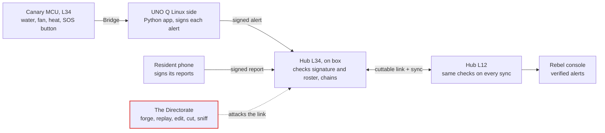

# Undercurrent rework: implementation plan

_Last updated: Tue Nov 17, 2026 — status column checked against the repo (`main` plus all pushed branches)._

**Where we actually are.** Everything in the "Keep" and "Drop" rows below is built, tested and merged, so the base the rework stands on is real. Nothing in the rework itself has been started: there is no crypto anywhere in the repo (no `pynacl`, no `tweetnacl`, no `sig`, `author_pub` or roster in any file, and neither library is in `hub/requirements.txt` or `web/package.json`), `sync.py` and `sim/simulate.py` are docstring stubs, and `firmware/`, `bridge/` and `web/app/hollow` don't exist yet. The whole Tuesday checklist is still open, and it's Tuesday. Three of the four working branches still sit exactly on `main` with nothing pushed since Monday evening; `michael/ai` is 2 commits ahead with all 200 eval labels reviewed, unmerged.

**This plan lists work, not assignments.** It all has to be done; whoever is free picks up the next thing. The one exception is the hardware — the Canary box, the UNO Q and the makerspace run are Tisya's, because she has the board.

## The idea

Canary boxes sense when something on a level is going wrong (flooding, the air supply stopping, heat) and announce it over the Undercurrent: a rebel channel the Directorate can't read, can't fake, and can't silence.

**Pitch line:** "The Directorate controls the network and the numbers. The Undercurrent is the one channel it can't read, can't fake, and can't shut up."

The channel carries two kinds of traffic:

- **Public alerts** (sensor alarms, SOS): signed, so anyone can read them and check they're real.
- **Cell messages** (organizing): encrypted, so only members can read them. Hubs relay them without being able to read them.

**Brief questions covered:** #10, #12, #13 and #14 by the box; #16, #17 and #18 by the channel. #22 (surface air) only if we get a real air sensor.

**Demo beats** (everything happens on the 3D Hollow map plus the physical box):

1. Water touches the probe on level 34's box. It beeps, and within seconds the alert lands on the other hub with a "verified" badge.
2. The Directorate (a teammate) cuts the link. Alerts queue. On reconnect, all of them arrive, none duplicated.
3. The Directorate injects "all clear, level 34." It's rejected because it isn't signed by a member, and the "forgeries blocked" counter goes up.
4. The Directorate edits an old record. The chain check points to the exact row.
5. The Directorate sniffs the channel. Its view shows gibberish for cell messages, while public alerts stay readable to everyone.

**Wording:** in the pitch, say "hidden rebel network," not "dark web." To judges, "dark web" sounds like crime markets.

## The sensor box (Canary)

Two or three sensors are enough, and every one can come from free parts, so nothing has to be ordered. The project's wow is the channel holding up against the Directorate, not the sensor count.

| Sensor | What it catches | Brief # | Parts |
| --- | --- | --- | --- |
| Water probe (two bare wires + a 10k resistor on an analog pin) | Flooding: water bridges the wires. Rough water quality: dirty or salty water conducts more | #14, #13 | Wire and a resistor from the makerspace bins |
| Fan monitor (Arduino counts a PC fan's tachometer pulses) | Ventilation stops, meaning the air supply is cut. Cooling falling behind | #10, #12 | A 12V PC fan plus a power supply. Fallback: a piezo taped to a USB fan to sense vibration |
| Temperature (thermistor or TMP36) | A level overheating | #12 | Bins |
| SOS button | A resident calling for help with no phone | #16, #17 | Any pushbutton |

Outputs: an LED and a buzzer for the local alarm. **Optional:** an air sensor (MQ-135 or SCD40), only if the makerspace has one. It unlocks "bad air" and #22.

**The board is an Arduino UNO Q, which makes the box its own hub.** It has two chips. The microcontroller side reads the sensors, runs the alert rules and sounds the alarm. The Linux side (Debian, Wi-Fi) runs our Python hub, signs every alert with PyNaCl, and syncs with the other hub over Wi-Fi. The two halves talk through Arduino's Bridge, and App Lab manages both. So there's no laptop bridge, and no "the laptop signs for it" caveat. ([specs](https://mischianti.org/arduino-uno-q-high-resolution-pinout-datasheet-schema-and-specifications/))

**Run the hub on the box without the heavy AI.** Install only fastapi, uvicorn, pydantic, httpx and pynacl. Skip torch and transformers, since the hub only loads them for compression. Set `TRIAGE_ON_INGEST=0`, or point `OLLAMA_URL` at a laptop. Sensor alerts get priority by rule anyway.

**Wiring:** the UNO headers run at 3.3 V, so pull the fan's tachometer line up to 3.3 V, not 5 V.

**Fallback:** if setting up the UNO Q eats more than a few hours, run the hub on a laptop and use the board only for sensing.

**Alert logic is plain rules, no AI.** A reading must stay past its threshold for 3 seconds in a row before it alerts, so one splash doesn't fire it. Fan RPM falling fast also alerts. Thresholds get tuned on the bench. Priority is set by rule, so a sensor alert never waits on the language model.

**Where the parts come from:**

- **CICS Physical Computing Makerspace** (CSL E302): bin components are free to take home. Boards and advanced sensors are checkout-only, stay on site, and go back each day. The 3D printer needs no certification (print the case). The laser cutter needs certification, so skip it. ([policy](https://make.cs.umass.edu/user_policy.html), [hours](https://make.cs.umass.edu/))
- **M5** is the ECE makerspace and is open to ECE students and faculty. As a CICS major, don't count on it unless an ECE friend brings you. ([UMass makerspaces](https://www.umass.edu/innovation/makerspaces))
- **UMass Amherst Makerspace** (Agricultural Engineering North) is open to all UMass students and has electronics stations. It's the backup.

## How hard the hardware is (realistic scope)

The minimum box is beginner-level and doable by Wednesday. The full box is a stretch. Smoothly, all the hardware is 8 to 12 hours of work. For a first hardware project, plan for about double, and sync still sits on top of that.

| Piece | Difficulty (first hardware project) | Time | Notes |
| --- | --- | --- | --- |
| UNO Q setup (App Lab, Wi-Fi, blink an LED, hello-world Python app) | Easy to medium | 1 to 2 hrs | New board, so expect a hiccup. Needs no parts, so do it first, at home |
| SOS button + LED + buzzer | Easy | 30 to 60 min | The classic first Arduino project |
| Water probe (two wires + resistor) | Easy | About 1 hr | One analog read. Keep the cup away from the board; only the wire ends go in the water |
| Temperature | Easy | 30 to 60 min | Easiest with a Modulino Thermo, which just plugs in |
| Fan monitor | Medium, the riskiest | 2 to 3 hrs | Needs a separate 12V supply and shared ground. Never put 12V on a board pin. Get staff to check the wiring, or cut it |
| Bridge (sketch to Python on the board) | Medium | 1 to 2 hrs | New API. Start from an App Lab example |
| Python: sign and post to the hub | Easy (software) | About 1 hr | Plain Python |
| Hub running on the board | Easy to medium | About 1 hr | If package installs fight back, run the hub on a laptop instead |

**The minimum box:** button + water probe + LED and buzzer, then Bridge, then Python signs, then the hub. That alone makes demo beat 1 work (water touches the probe, the box beeps, a verified alert appears on the other hub). Every other demo beat is software and needs no more sensors. Temperature and the fan get added only after the minimum box works end to end.

**Build order:**

1. Tonight or early Tuesday, at home: UNO Q setup.
2. Tuesday at the makerspace: button, LED, buzzer, water probe. Ask staff or a student ambassador to look over the wiring.
3. Tuesday night: sync.
4. Wednesday: Bridge, signing and posting, then temperature, then the fan if there's time.
5. Thursday: film.

**If Tuesday goes badly:** hand sync to whoever is free instead of cutting the box. Sync is software and can move; the box can't, since it needs the board in hand.

## Makerspace list

Every must-have is a basic bin part, so the minimum box should be buildable in one visit to the CICS makerspace. The likelihoods are estimates: the online catalog only lists batteries, so email PhysicalComputing@umass.edu to confirm before going, and update each Likelihood to "Got it" or "Not there" after the visit.

**Rules that matter:** bin parts are free to take home. Checkout items (boards, advanced sensors, meters) stay on site and go back daily, so anything checked out gets filmed there.

| Part | What it's for | Need | Likelihood | Fallback |
| --- | --- | --- | --- | --- |
| Breadboard | Holds everything with no soldering | Must-have | Very likely | Any electronics station |
| Jumper wires | All connections | Must-have | Very likely | None needed |
| Resistors (10k for the probe, 220 to 330 ohm for the LED) | Water probe, LED | Must-have | Very likely | None needed |
| LEDs (red, green) | Local alarm light | Must-have | Very likely | Modulino Pixels |
| Pushbutton (a big one reads better on camera) | SOS button | Must-have | Likely | Modulino Buttons |
| Piezo buzzer | Alarm sound | Must-have | Likely | Modulino Buzzer, or light only |
| Bare wire + tape | The two probe wires | Must-have | Very likely | Strip the ends of two jumpers |
| Multimeter (on site) | Checking wiring when something doesn't work | Must-have | Very likely | Ask staff |
| Thermistor or TMP36 | Temperature | Bonus | Maybe | Modulino Thermo, or skip |
| 12V PC fan with 3 or 4 pins | Air supply monitor | Bonus | Maybe | Piezo on a USB fan, or skip |
| 12V supply (bench supply or wall adapter) | Powers the PC fan | Bonus | Likely | Film the fan shots on site |
| Air sensor (MQ-135, SCD40, CCS811, SGP30 or BME680) | Bad air, and #22 | Bonus | Unlikely | Drop the air claims |
| 3D-printed case | Makes it look like a real device | Bonus | Very likely | A small cardboard box |

**Bring from home:** the UNO Q, its USB-C cable and power supply, a cup, water and a pinch of salt (salty water makes the probe react more clearly).

## The channel: encrypted and verifiable

Every message is signed by a known member, and every hub checks it before storing or relaying it. That's what makes forged, replayed or edited messages fail on camera. Cell messages are also encrypted, so hubs carry them without reading them.

Every message passes the same checks at every hub. That leaves the Directorate one move that works, cutting the link, and queued messages arrive anyway on reconnect.

**Keys.** Every member (a phone) and every Canary box has an Ed25519 keypair. Use PyNaCl on the hubs, including the box, and tweetnacl in the web pages. A phone makes its key on its first visit and keeps it in the browser.

**Joining a cell happens in person.** At a hub, an operator scans the member's QR code (their public key) and adds it to the roster. The roster is itself a signed event in the log, so it syncs to every hub. The Directorate can't join remotely. For the demo, pre-load the keys.

**Envelope.** The existing event gets three new fields:

- `author_pub`: the sender's public key.
- `sig`: a signature over the event's content.
- For cell messages only, `payload` becomes `{nonce, ciphertext}`, encrypted with the cell's shared key.

**Two things in today's log code have to change before anything can be signed.** Both are in `hub/app/log.py` and `hub/app/models.py`:

1. **The hub invents `id` and `created_at` itself.** `log.append()` calls `uuid.uuid4()` and `datetime.now()`, and `EventIn` has no `id` or `created_at` field, so a client can't sign them. The signer (box or phone) has to set both before signing, and the hub has to accept them instead of generating them. Replay protection depends on this too: a server-generated uuid is new every time, so "the event id is new" can never catch a replay.
2. **`priority` is deliberately outside the hash.** `compute_hash()` covers `id`, `type`, `hub_id`, `level`, `created_at`, `author` and `payload` only, because the hub scores priority on arrival. Keep `priority` outside the signed content for the same reason, or every synced event's signature breaks once a hub rescores it. Sign exactly the seven fields the hash already covers, plus `author_pub`.

Also worth deciding at the same time: `EventType` is a closed list of four (`checkin`, `hazard`, `case`, `missing_person`), so a sensor alert needs a home. Hazard already has the right kinds (`flooding`, `bad_air`, `bad_water`, `heat`, `blackout`), so sensor alerts fit as `hazard` with `source: "sensor"`, and the SOS button fits as `checkin` with `status: "need_help"`. No new type needed.

**What a hub checks before it stores anything** (on `POST /events` and on sync):

1. The signature is valid.
2. `author_pub` is on the roster.
3. It isn't a replay: the event id is new, and its time is within a short window.
4. It chains correctly within its origin hub's own chain. One chain per hub, which also fixes the sync merge problem.

Anything that fails goes to a "rejected" list with the reason. That list feeds the demo counter and our numbers.

| Directorate move | What happens | Where it's caught |
| --- | --- | --- |
| Forge an alert, or post a fake "all clear" | Rejected: unknown key or bad signature | Hub on arrival |
| Replay an old alert | Rejected: duplicate id | Hub on arrival |
| Edit a stored record | Chain check fails at that exact row | `/events/verify` |
| Cut the link or kill a hub | Messages queue, then arrive on reconnect with 0 lost | `link.py` + sync |
| Read the channel | Cell messages are unreadable. Public alerts are meant to be read | Encryption |

**Honest limits:**

- **Metadata is visible.** Hubs can see who sent a cell message, when, and from which level. Hiding that, the way Tor does, is out of scope.
- **A stolen phone can sign** until a roster event removes its key.

## The look: the 3D Hollow, and a clean console

The Hollow is a vertical stack, so depth is the subject matter, not decoration. That's the one place 3D earns real effort: a slow push down the shaft while level 34 flares red says "this city goes down, and the bottom is dying" in about five seconds, and no flat list does that. It's the video's opening shot and the Devpost hero image.

**What the map is actually for.** Two concrete jobs, plus one honest limit.

1. **It makes the box land.** Without the map, demo beat 1 is: water touches a wire, the box beeps, a row appears in a table. With it, water touches a wire and *a level of the city lights up*. Same event, completely different impact — and it's the thing that ties the physical box to the network story instead of leaving it a gadget next to a laptop.
2. **It explains the cut better than a dashboard can.** Beat 2 is the Directorate severing the link. Flat, that's a number going up and then down. On the map it's the line between L34 and L12 going dark, alerts visibly piling up, then the line returning and the pile draining. That's the one beat where the map explains something words don't.
3. **The honest limit: it proves nothing.** Every claim is proved by the hub's checks and counters — forgeries rejected, the chain naming the tampered row, zero lost after a cut. The map only shows what already happened. It's worth building because judges decide fast and it makes forty levels of context free; it is not worth anything else breaking for. If it ever comes down to the map or sync, sync wins.

Everything else in the demo is reading. Verified badges, the "forgeries blocked" counter, ciphertext against plaintext, the chain check naming an exact row, priority order — all text and tables, all worse in 3D, and all days of work there. So:

- **`web/app/hollow` is real 3D** and it's the hero view. 40 level slabs in one `<Instances>`, y by level, emissive brightness from that level's worst live alert, two hub nodes (L34 and L12) with a line between them that goes dim and dashed when the link is cut, slow auto-orbit, bloom. Bloom is what makes it look expensive for about ten lines.
- **The console stays flat and dense.** Four of the five demo beats are proved there, and reading speed is the whole job.
- **The Directorate view stays 2D,** side by side. Ciphertext has to read as gibberish, which means monospace text.

**The rule that keeps this safe: the map is never the only place a demo beat is visible.** Every beat has to be provable on the flat console. That turns the Wednesday-noon call from a fork between two builds into one switch — ship the map or don't — and cutting it costs a pretty shot, not a demo beat.

**Dependencies** (checked Nov 17): `@react-three/fiber` 9.8.2, `@react-three/drei` 10.7.9, `three` 0.187.0, and `@react-three/postprocessing` 3.2.2 for bloom. R3F 9's peer range is `react-dom >=19 <19.4` and the lockfile holds 19.3.1, so it works today — but `web/package.json` asks for `^19.1.0`, which will pull 19.4 the day it ships and break the install mid-week. **Pin `react` and `react-dom` to exactly `19.3.1`.** The route also needs `'use client'` plus a `next/dynamic` import with `ssr: false`, or the Next 15 app-router build dies on `window`.

**A clean console is cheaper than the map and matters more.** `globals.css` already has a coherent dark token set (`--background`, `--panel`, `--border`, `--foreground`, `--muted`, `--accent`, `--danger`, `--ok`). Two gaps, about an hour between them:

1. **No font is set at all.** `layout.tsx` loads none, so every page renders in the browser default. One `next/font` sans plus one mono — for the hashes, public keys and ciphertext that are all over this demo — is five lines and the single biggest visual lift available.
2. **Use the tokens everywhere** instead of ad-hoc Tailwind colors, and have the map's emissive colors read from the same ones, so the console and the Hollow look like one product instead of two projects.

## What we reuse from the repo

Most of the repo carries over. Of 18 pieces, 4 stay as they are, 7 change, 5 are new, and 2 drop out of the demo. The new work is sync, the box, the simulation and the 3D map.

| Piece | Plan | Status (Tue Nov 17) | What changes |
| --- | --- | --- | --- |
| `hub/app/sync.py` (stub today) | Build | ❌ Not started. 11-line docstring, no code | Union by id. Check signature and chain on arrival |
| `hub/app/log.py` (hash-chained log) | Change | 🟡 Built and tested; chain + `verify()` work. Needs the per-hub chain and the signing fields | One chain per origin hub. Store `author_pub` and `sig` |
| `hub/app/main.py` (events, verify, stream, link) | Change | 🟡 `/events`, `/events/verify`, `/events/stream`, `/link`, `/health` all live. No checks, no `/rejected`, no `/roster` | Signature, roster and replay checks on `POST /events`. Add `GET /rejected` and `POST /roster` |
| `hub/app/link.py` (slow, cuttable link) | Keep | ✅ Done, 120 lines, tested | Nothing. It's demo beat 2 |
| `hub/app/stream.py` (live feed) | Keep | ✅ Done, SSE with resume | Nothing. It feeds the console |
| `hub/app/triage.py` + `ingest.py` (AI priority) | Keep | ✅ Done and wired in. `TRIAGE_ON_INGEST=0` already exists, so the box-install plan works as written | Resident free-text SOS still gets AI priority. Sensor alerts skip it |
| `hub/app/organize.py` + `ai_routes.py` | Keep | ✅ Done | No new work |
| `hub/app/compress.py` (200-byte compression) | Drop from demo | ✅ Built and tested, never wired into the hub, so dropping it costs nothing. Numbers already measured | One line in the writeup |
| `hub/app/scheduler.py` (fair scheduler) | Drop from demo | ✅ Built and tested, never wired into `link.py`, so dropping it costs nothing. Numbers already measured | Out of the video |
| New: `firmware/canary.ino` | Build | ❌ Not started. No `firmware/` directory | Sensors, alert rules, alarm. Sends readings to the Linux side over Bridge |
| New: `bridge/canary_bridge.py` | Build | ❌ Not started. No `bridge/` directory | Runs on the UNO Q's Linux side: gets readings over Bridge, signs them, posts to the hub on the same board |
| `shared/schemas/event.schema.json` | Change | ❌ Not started. No `author_pub`, `sig`, `source` or `device_id`. `models.py` and `web/lib/types.ts` mirror it and change with it | Add `author_pub`, `sig`, `source` (sensor or resident), `device_id`, and the encrypted payload. Post in the group chat before merging |
| `web/lib/hub.ts` + phone pages | Change | 🟡 All 4 forms + `hub.ts` work end to end. No keys, no signing, no cell-message page. `tweetnacl` isn't installed | Make a key on first visit and sign every report. Add a "cell message" page that encrypts |
| `web/app/dashboard` | Change | 🟡 275 lines and live: priority queue, SOS flash, missing-persons search, bandwidth slider, cut button. No verified badges, counter or Directorate toggle | Becomes the rebel console: verified badges, "forgeries blocked" counter, Directorate-view toggle |
| `web/app/truth` (stub today) | Change | ❌ Not started. 9-line placeholder | Becomes the Directorate view: what they see (ciphertext, fake numbers) vs reality |
| New: `web/app/hollow` (3D map) | Build | ❌ Not started. No route, and no 3D library in `web/package.json` — the Wed-noon 2D/3D call also means picking a dependency | Levels light up from live alerts |
| `sim/simulate.py` (stub today) | Build | ❌ Not started. 9-line docstring. `sim/world.json` is still scaffold placeholders. `origin/feature/simulation` is an empty "dummy push" | Simulated canaries and residents on other levels, each with its own key. Plus the Directorate attack script |
| `eval/` | Change | 🟡 Triage, compression and fairness harnesses done with real numbers and 95% CIs in `eval/results/RESULTS.md`. No security eval. The 200-label review is done on `michael/ai` but unmerged, so the held-back test run is unblocked | Add the security eval (see "Numbers, cuts and risks"). Triage results stay as supporting numbers |

## What needs to be done, and when

Three checkpoints get us to a recorded demo by Thursday, with Friday as buffer. Judging closes Fri Nov 20 at 11:59 PM EST. The submission deadline still needs confirming in the Discord. If a checkpoint slips, cut scope rather than move the video.

No names on the software items: it all has to be done, so whoever is free takes the next one. The hardware items are marked, because the box needs the board in hand.

**Tue Nov 17, night: the channel works between two hubs** — every item below is still open, and today is Tuesday.

- [ ] `sync.py` with one chain per hub. Two hubs get cut and reconnected with 0 lost, proven by a stress script. *Not started; `sync.py` is still the stub. `link.py` is ready and waiting for `poll()` to be drained.*
- [ ] The schema change, posted in the group chat before merging. It has to settle client-set `id` and `created_at` first (see the channel section), because sync and replay checks both depend on it. Nothing else can be signed until this lands, so it's the first domino.
- [ ] Signature, roster and replay checks on `POST /events`, plus `GET /rejected` and `POST /roster`.
- [ ] Phone pages make a key on first visit and sign every report. *`tweetnacl` isn't in `web/package.json` yet.*
- [ ] The sim posts signed events from fake canaries on other levels. *`simulate.py` is still a 9-line stub.*
- [ ] The console shows verified badges and the rejected counter, built against fake events. *The console it builds on is done and live.*
- [ ] **Hardware (Tisya):** makerspace run — bin parts, a PC fan, and check for an air sensor. Then set up the UNO Q (App Lab, Wi-Fi), run the hub on it, and read the water probe and the button. *Before installing the hub on the board, see the `requirements.txt` note in the open questions.*

**Wed Nov 18, night: tag demo-v1** — nothing started; every item here depends on Tuesday landing.

- [ ] The Directorate attack script: forge, replay, edit. *The edit half is nearly free — `GET /events/verify` already returns `first_bad_event`, so demo beat 4 works today against a tampered DB.*
- [ ] The security eval numbers (the four headline numbers below).
- [ ] The cell message page: encrypt and decrypt.
- [ ] The Directorate view page (`web/app/truth`, a placeholder today).
- [ ] The 3D Hollow map lit by live alerts (see "The look"). Build it as a bonus panel, never as the only place a beat is visible, so the Wed-noon call is just ship-or-don't. *Add the four deps and pin react to 19.3.1 first.*
- [ ] **Hardware (Tisya):** the box's Python app signs and posts real alerts. Then the fan monitor and the temperature sensor. Optional: a Directorate kill switch on the board that calls `POST /link` to cut.
- [ ] Set a font in `layout.tsx` (one sans, one mono) and sweep the pages onto the existing CSS tokens. ~1 hr, lifts all five pages, independent of the map.
- [ ] Run the full demo 3 times in a row without touching code.

**Thu Nov 19: video and Devpost**

- [ ] Edit the video.
- [ ] The Devpost results section.
- [ ] The Devpost story and world framing.
- [ ] **Hardware (Tisya):** film the box shots — water on the probe, the kill switch.

**Fri Nov 20:** buffer, then submit early.

## Numbers, cuts and risks

The video and Devpost lead with four measured numbers. All four come from the attack script and a cut/reconnect stress test, so they're cheap to produce once the channel works.

**Headline numbers:**

1. Forged and replayed messages accepted: 0 of N.
2. Edited records caught by the chain check: N of N.
3. Alerts delivered after random link cuts: N of N, with 0 duplicates.
4. Time from water on the probe to the alert on the other hub: median X seconds.

**Cut from scope:** compression, the fair scheduler, multi-hop peer-to-peer, the 10k-resident scale, room scanning, and the LED model of the Hollow.

**Risks and fallbacks:**

- **Signing on phones isn't done by Tuesday night:** phones post to the hub and the hub signs for them. It's weaker, and we say so.
- **UNO Q setup eats the day:** run the hub on a laptop and use the board only for sensing.
- **No air sensor:** drop the bad-air and surface (#22) claims. Water and the fan carry the demo.
- **The 3D map isn't ready:** cut the panel, keep the console. Nothing depends on it, by design.
- **The PC fan needs 12V:** use the piezo on a USB fan instead.
- **Sync and the box are both on one person's plate Tuesday:** if sync slips past Tuesday night, someone else picks up the box's Python app. The box is the only piece that can't move, since it needs the board.
- **The schema change blocks four other items.** If it isn't posted and merged Tuesday, signing, the checks, the phone keys and the sim all stall. Land it first, even rough.

**Open questions:**

- **Split `hub/requirements.txt` before putting the hub on the UNO Q.** It pins `torch` and `transformers`, which only `compress.py` needs, and compression is cut from the demo. A plain `pip install -r` on the board pulls hundreds of MB it will never use. Split into a hub list (fastapi, uvicorn, pydantic, python-dotenv, httpx, pynacl) and an AI list.
- **Which two levels?** Demo beat 1 and the diagram say L34 and L12; `sim/world.json` and the `HUB_ID` default say L38 and L12. Pick one pair and change the other.
- Did the UNO Q come with any Modulino modules (Thermo, Buzzer, Pixels, Buttons)? They plug in with no wiring.
- What's the submission deadline and video length limit? Check the Discord.

## Sources

- [CICS Physical Computing Makerspace: user policy](https://make.cs.umass.edu/user_policy.html)
- [CICS Physical Computing Makerspace: hours and location](https://make.cs.umass.edu/)
- [UMass Amherst makerspaces, including M5 access](https://www.umass.edu/innovation/makerspaces)
